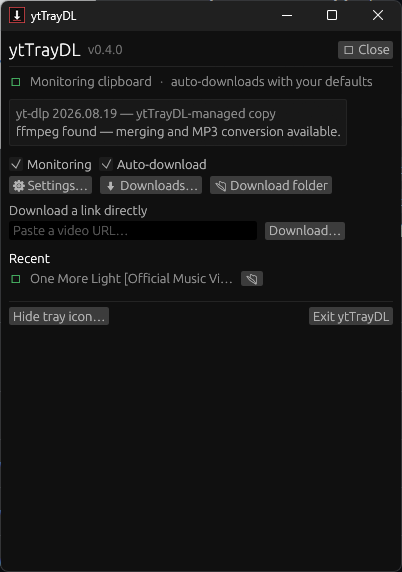
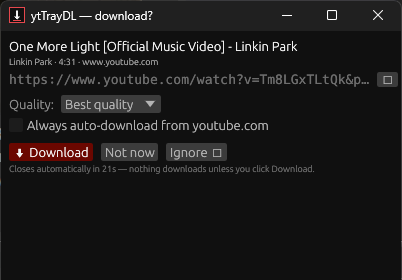
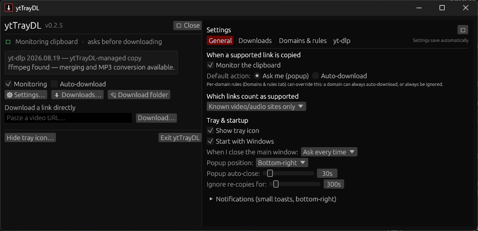
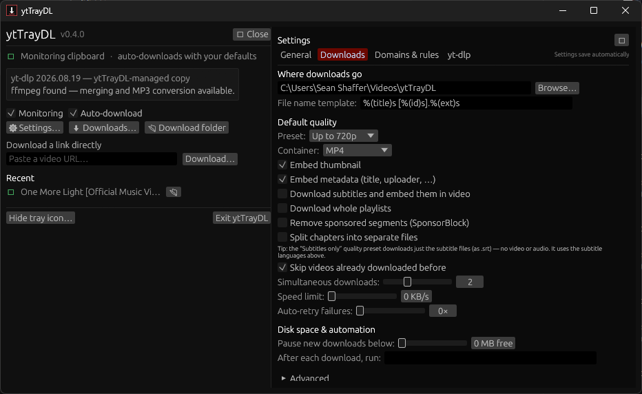
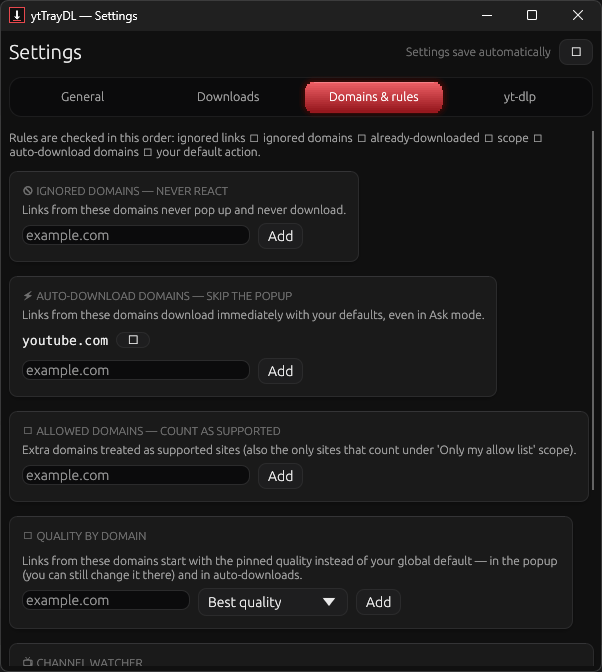
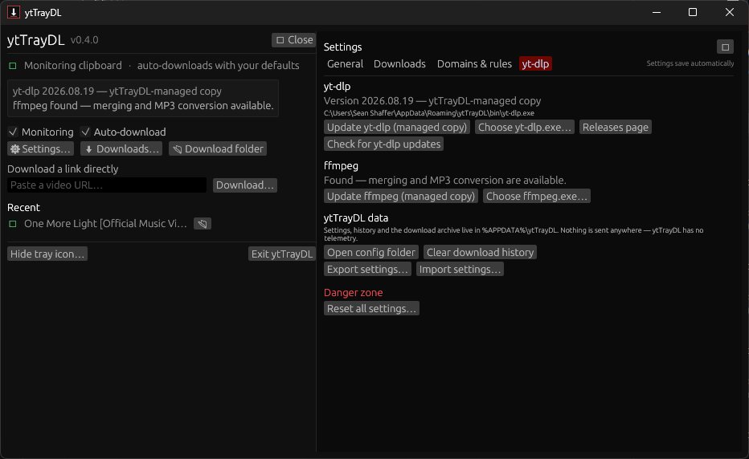
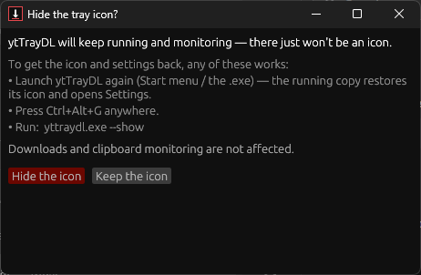

# ytTrayDL

**Copy a video link. It downloads.** ytTrayDL is a small Windows system-tray
companion for [yt-dlp](https://github.com/yt-dlp/yt-dlp). It watches your
clipboard, and when you copy a link from a site yt-dlp supports, it either
pops up a small window with download options — or, if you've told it to,
downloads quietly in the background with your defaults while you keep working.


Settings use bounded pages, never scrollbars. Related controls share a page when
space permits; use the section arrows and Previous/Next page controls to reach
all options. Domain rules and watched channels have independent list pages.
Window resizing and tool-download progress adjust page capacity without changing
saved preferences.

The 0.8.1 responsiveness candidate fixes a measured GUI geometry stall and adds
visible tool-download progress and cancellation. See the
[responsiveness verification contract](docs/GUI-RESPONSIVENESS-0.8.1.md).
Earlier [0.8.0 verification notes](docs/RELEASE-0.8.0.md) retain their historical
scope; they do not qualify the new binary automatically.

## TL;DR

ytTrayDL watches your clipboard for video links and downloads them
with yt-dlp: it asks first (a popup with a quality choice) or
downloads silently with your defaults — your rules per site, no
duplicates, no telemetry. It's for anyone who downloads
videos regularly and wants it to feel built into Windows rather
than like a chore in a terminal. Free and open source (MIT),
for Windows 10/11, in a 64-bit build, as an installer
or a portable zip.

## How it works

1. Run `yttraydl.exe`. The control panel opens; close it and the
   app keeps running in the system tray (notification area). Only
   Start-with-Windows launches skip the panel and go straight to
   the tray.
2. Copy a link — from a browser, a chat app, anywhere — or paste
   one into the panel's link box.
3a. **Ask mode (default):** a small popup appears near the corner of your
    screen with the video's title, a quality selector, and Download /
    Later / Not now / Ignore options.
3b. **Auto-download mode:** no popup at all. The download starts immediately
    with your default quality and folder; a small toast confirms it finished
    (and failures are always reported, never silent).

The **Video converter** opens from the panel or tray, or via the optional
installer desktop shortcut (`yttraydl.exe --converter` in portable mode). It
converts local files to MP4, MKV or WebM using ffmpeg. Video profiles include
H.264, HEVC, VP9 and AV1, plus selectable encoding quality. Audio-only MP3,
M4A, FLAC and Opus profiles extract or convert the first audio stream, with
optional lossy bitrate selection; FLAC remains lossless. HEVC and AV1
require an ffmpeg build with the corresponding encoder; AV1 can be slow.
For one file, select a new output filename with the matching extension. For a batch, select multiple
files and an existing output folder; files are converted sequentially to
`<name>.converted.<extension>`. Before starting, the batch rejects existing
outputs and colliding names. A batch stops on the first error or cancellation;
completed outputs are kept and a partial output may remain. Closing the
window leaves conversion running. An optional start/end trim in seconds can be
applied to a single file or every item in a batch. Trimming re-encodes the media
rather than doing lossless stream-copy cutting. Optional numeric cropping is
applied before a fit-within resize preset (480p through 4K); resizing preserves
aspect ratio and does not upscale. Rotation (90°, 180° or 270°) is applied
after cropping and before resizing. Audio can be removed from video outputs.
Crop coordinates are in source pixels, and
ffmpeg can adjust offsets at frame edges; some encoders require even crop
dimensions. Batch inputs can be reordered or removed before conversion. Live
status reports the current file and encoded media time. When ffprobe can read
a container duration, an approximate per-file percentage and ETA are also shown;
trim, unusual timestamps and variable encoding speed can make estimates
inaccurate. If duration is unavailable, conversion still runs without an
estimate. Optional NVIDIA NVENC, Intel Quick Sync and AMD AMF video encoders are
available for H.264 or HEVC MP4/MKV profiles. They require a compatible GPU,
driver and ffmpeg build; failures do not silently fall back to software. Hardware
uses encoder-default quality rather than the software CRF choices. Hardware
encoding has not been tested on real Windows hardware.

The **Lyrics & tags** window opens from the panel, tray, optional installer
shortcut, or `yttraydl.exe --tags`. Load a local MP3, M4A, FLAC, OGG or Opus
file to inspect title, artist, album, album artist, track, date, genre and
lyrics detected by ffprobe. Embedded JPEG or PNG artwork can be exported to a
new image file without modifying the input. You can also choose a JPEG or PNG
(up to 10 MiB) to replace embedded artwork in a new MP3, M4A or FLAC copy.
Edit the fields or enter missing lyrics manually. An optional online search sends
the entered title and artist to LRCLIB only when you click Search; review and
choose a result to fill an empty lyrics field. Search needs an internet
connection and curl; results may be inaccurate or unavailable. Export creates a
new file with the same extension. The original and existing output files are not overwritten. Detected
lyrics are not deliberately replaced; ffmpeg remuxing may omit or alter tags,
lyrics or artwork it cannot represent, so verify the copy. ffmpeg and ffprobe
are required for tag inspection and export, and a failed or cancelled export
may leave a partial output. Closing the window leaves the job running.

The **Player** opens from the panel, tray, optional desktop shortcut, or
`yttraydl.exe --player`. It manages a queue of up to 500 local audio and video files, with reorder,
remove, repeat, previous, next and stop. Add a folder to scan for supported media
in its subfolders; the cancellable scan skips symbolic links and Windows reparse
points and has entry, depth and queue limits. Inaccessible entries are reported.
You can also import UTF-8 M3U/M3U8 playlists: relative paths resolve against the
playlist folder, while URLs, network-share entries and nested playlists are
skipped. Import appends paths only; it never fetches media or starts playback.
Export writes a UTF-8 M3U/M3U8 with absolute paths to a new file; existing
files are never overwritten. It rejects queues containing network shares, URLs,
non-UTF-8 or multiline paths, and an I/O failure may leave a partial file.
Filter the queue by path without changing
playback order; Up and Down move entries within the full queue, including hidden
items. Remove duplicate paths keeps the first occurrence and preserves the
selected track; it compares paths lexically without accessing files or ignoring
case. In Media & playback options, you can
explicitly save or replace one queue, append its entries later, or delete the
saved queue. Saving records file paths in `player-queue.json` in the normal or
portable app data folder; it does not save media or automatically resume
playback. The queue is otherwise session-only, and app data is retained on
uninstall. Playback
uses a separate ffplay window: Space pauses, arrows seek, 9/0 adjust volume and
M mutes. Closing that playback window advances the queue; closing the manager
does not stop playback. The starting volume applies when each track starts.
Use Save player options and Restore player options to explicitly store or
restore the ffplay path, starting volume and repeat preference in app data.
Restoring options never starts playback. The options section scrolls separately
on smaller windows.
ffplay is **not** included in the managed ffmpeg download or installer; install
it separately, put it next to the selected ffmpeg or on PATH, or select its
executable in the player options. Network playback is not supported; playlist files are imported into the queue,
not played directly. The player and its Windows shortcuts have not yet been interactively
verified on Windows.

The installer can optionally create a separate **ytTrayDL Downloads** desktop
shortcut. It opens the Downloads window, including when ytTrayDL is already
running. Portable users can launch `yttraydl.exe --downloads` directly.

Right-click the tray icon to pause monitoring, switch modes, open Settings,
open the download folder, and more. Left-click toggles the control panel —
click once to show it, click again to hide it.

## Highlights

- **Real clipboard events, not polling** — ytTrayDL registers as a Windows
  clipboard format listener (`AddClipboardFormatListener` /
  `WM_CLIPBOARDUPDATE`), so it reacts instantly and idles at zero cost.
- **Per-domain rules** — ignore a domain forever, auto-download from the
  ones you trust, allow extra domains beyond the built-in list.
- **Sensible scope** — by default only known video/audio sites trigger it;
  ordinary web links don't. Switch to "any link" if you use yt-dlp's
  long-tail sites.
- **No duplicates** — re-copying the same link doesn't re-trigger, and a
  yt-dlp download archive means previously downloaded videos are skipped
  (the popup offers "Download anyway" when yt-dlp detects one).
- **Progress you can see** — live percent, speed and ETA in the panel and
  Downloads window, parsed from yt-dlp's own output.
- **Full queue control** — in the Downloads window: reorder what's next,
  pause and resume (a resume continues the partial file, it doesn't
  restart it), retry failures with their original quality, and pause
  or cancel everything at once — Pause all is in the tray menu too.
- **Quality by domain** — pin a quality per site ("this domain always
  ≤720p, that one always MP3"): the popup starts there and
  auto-downloads use it too.
- **Playlists, your call each time** — a playlist link asks in the popup:
  just this video, or the whole playlist.
- **Cleaner downloads** — optional SponsorBlock segment removal,
  a Windows taskbar progress bar while downloads run, an optional
  finish sound, and drag-and-drop: drop a text file of links onto
  the panel and they're processed like copied links.
- **A popup that shows its work** — thumbnail, resolution and
  approximate size before you commit, a per-download "Save to"
  folder, and a "Later" button that parks the link in the panel's
  Saved list for when you're ready.
- **Subtitles-only and audio your way** — a preset that fetches
  just the subtitle files (`.srt`, no video or audio), and audio
  presets for MP3, M4A, Opus, FLAC, WAV or the original format.
  Settings → Downloads → Quality offers encoder quality or 128–320 kbps
  for MP3, M4A and Opus; this cannot improve the source quality.
  Original and lossless audio are unaffected. yt-dlp may preserve an
  existing matching audio format instead of re-encoding it, so the chosen
  bitrate is a conversion target, not a guarantee.
- **Channel watcher** — subscribe to channels or playlists and
  new uploads download themselves on an interval you choose
  (hourly by default).
  The first check only takes stock; no back-catalogue dumps.
- **Set-and-forget safety nets** — a failure banner with one-click
  retry, a low-disk-space guard that pauses the queue, an optional
  action when the queue empties (sound / sleep the PC / exit),
  a post-download command hook, chapter splitting, and a true
  portable mode (`portable.txt` next to the exe).
- **Hide the tray icon if you want** — with three ways back: relaunch
  ytTrayDL, press **Ctrl+Alt+G**, or run `yttraydl.exe --show`. The
  confirmation dialog explains this before hiding, so you can't lock
  yourself out.
- **First-run friendly** — if yt-dlp isn't installed, one click downloads
  the official standalone `yt-dlp.exe` from GitHub into ytTrayDL's own
  folder. Same for ffmpeg: if it's missing, one click downloads the GyanD
  essentials build (the Windows build ffmpeg.org links to) and unpacks
  it next to yt-dlp. Best-quality merging and MP3 conversion need ffmpeg.
- **Visible tool updates** — Main and Settings show the actual download stage,
  bytes, total, speed and ETA when available. Cancel stops that operation and
  preserves the previous managed tools; a failed worker offers retry.
- **Closing the window is your choice** — the X button asks: Exit,
  minimize to tray, minimize to taskbar, or hide entirely (keeps
  running in the background; **Ctrl+Alt+G**, relaunching, or `--show`
  brings it back). Tick "Remember my choice" to stop being asked, and
  change it any time in Settings → General.
- **Private by design** — no accounts or telemetry. Network traffic includes
  yt-dlp requests, thumbnail fetches, and explicit update checks or component
  install/update requests. Settings and history stay on your PC in
  `%APPDATA%\ytTrayDL` (or the portable data folder).

## Screenshots

The control panel — status, manual link downloads, recent activity:



Copy a link and the popup asks first — title, quality, one click
to download:



Settings opens in its own window — one tab at a time. General: clipboard behaviour, tray & startup, popup
position, what happens when the queue empties:



Downloads: folder, filename template, default quality,
subtitles, SponsorBlock, split chapters, the low-disk guard
and a post-download command:



Domains & rules: ignored / auto-download / allowed domains,
quality pins per domain, and the channel watcher:



yt-dlp: managed yt-dlp and ffmpeg updates, settings
export/import, and the data folder:



Hiding the tray icon is always explained first — and always
recoverable:



## Quick start

Two ways to get it from the
[Releases page](https://github.com/SeanShaffer88/ytTrayDL/releases)
— downloads are 64-bit (`-x64`) builds:

- **Installer** — `ytTrayDL-Setup-vX.Y.Z-windows-x64.exe`:
  per-user install (no admin) to
  `%LOCALAPPDATA%\Programs\ytTrayDL`, with a Start-menu entry,
  optional desktop shortcut and start-with-Windows, and a
  standard uninstaller. Your settings/history in
  `%APPDATA%\ytTrayDL` are kept on uninstall.
  The **Download Tools** page selects **Download Latest Tools** by default:
  Setup fetches the latest stable official yt-dlp and ffmpeg essentials builds,
  verifies their release hashes, and prepares ffprobe too. About 150 MB is
  downloaded; the tools are downloaded instead of bundled to keep Setup small
  and resolve current versions at installation time.
  Choose **Skip Downloads — Install Offline** to avoid all tool-download
  traffic and automatic application launch; existing tools remain available.
- **Portable zip** — `ytTrayDL-vX.Y.Z-windows-x64.zip`:
  unzip anywhere and run `yttraydl.exe`.
  Nothing is installed.

Then:

1. Run it. If yt-dlp is missing, the panel opens with an **Install yt-dlp**
   button.
2. Copy any supported link and try it.

Optional: enable **Start with Windows** in Settings (per-user, no admin
needed). If ffmpeg is missing, use the panel's **Install ffmpeg** button
(or drop `ffmpeg.exe` next to `yttraydl.exe` / on PATH yourself).

For unattended Setup, downloads are required unless `/TOOLSDOWNLOAD=skip` is
explicitly supplied. A required download or verification failure returns a
nonzero installer exit before application files are installed. Interactive
failures offer **Retry**, **Skip Tools**, and **Cancel Setup**. The progress
indicator describes the overall operation; it does not invent a percentage.
During a download Setup waits for the bounded helper to finish before it can
cancel. Settings, history, existing managed generations and user media survive
failure and uninstall; a successful tool update does not roll back if a later
application installation step fails.

The same provider is available without the GUI:
`yttraydl.exe --provision-tools all --report C:\\ExistingFolder\\new-report.json`.
Selection may be `all`, `yt-dlp`, or `ffmpeg`; the report path must be new and
its parent must exist. This mode does not start clipboard monitoring or a
second UI instance. See [installer tool verification](docs/INSTALLER-TOOLS.md).

## Configuration tour

**Settings → General** — monitoring on/off, default action (Ask /
Auto-download), detection scope, popup position and auto-close timer,
dedupe window, which notifications you want (finished / failed /
auto-start, an optional finish sound, opening the download folder
on finish), tray icon visibility,
start-with-Windows, the Settings-panel animation toggle, and what
happens when the download queue empties (nothing / a sound / sleep
the PC / exit).

**Settings → Downloads** — download folder, file-name template, default
quality preset (Best, up to 2160p/1440p/1090p/720p/480p/360p, audio
MP3/M4A/Opus/FLAC/WAV/original, subtitles-only, or a custom yt-dlp
format string), container (MP4/MKV/original), embed
thumbnail/metadata/subtitles, playlist behaviour, SponsorBlock
segment removal, chapter splitting, simultaneous download count, a
speed limit, auto-retry for failed downloads, a low-disk-space
guard, a post-download command, extra yt-dlp arguments, and
browser cookies from a dropdown (Chrome, Edge, Firefox, Brave, Opera,
Vivaldi, Chromium — for signed-in content; yt-dlp reads them, ytTrayDL
never sees them).

**Settings → Domains & rules** — the ignored / auto-download / allowed
domain lists, per-domain quality pins, the channel watcher
(subscriptions + poll interval), and ignored specific links, with
the rule order explained.

**Settings → yt-dlp** — the yt-dlp/ffmpeg copies in use, one-click
install/update, a "Check for yt-dlp updates" button that compares
your copy against the latest GitHub release, and export/import of
all settings (rules included) as a JSON file — plus the config
folder, clear-download-history, and a reset-all-settings
Danger zone.

**Tray menu** — pause/resume monitoring, auto-download toggle, "Download
from clipboard" (acts on what's copied *now*), Downloads, download
folder, pause/resume all downloads, Settings, start-with-Windows,
hide icon, About, Exit.

**Command line**

| Argument | Effect |
| --- | --- |
| `yttraydl.exe --show` (or `--settings`) | If already running: restore the tray icon and open Settings. If not running: start with the panel open. |
| `yttraydl.exe --background` | Start in the tray without opening the panel (used by Start-with-Windows). |
| `yttraydl.exe https://…` | Treat the URL like a copied link (opens the download popup). |

**Your data** — everything lives in `%APPDATA%\ytTrayDL`:
`settings.json`, `download-archive.txt` (yt-dlp's already-downloaded
list), `history.json`, `saved.json` (Saved-for-later links),
`watch.json` (channel-watcher state), `yttraydl.log` (diagnostics),
and `bin\` (the managed yt-dlp/ffmpeg copies). Portable mode moves
all of it into a `ytTrayDL-data` folder beside the exe when a
`portable.txt` file sits next to it.

## Window geometry module

On Windows, the application keeps normal window bounds in `window-state.json` in its own
configuration directory, alongside settings. Main, Settings and Downloads retain
size and position; About retains position. Hidden, minimized and maximized states
are not restored. Transient prompts stay anchored and are kept inside the current
monitor work area. Missing or invalid saved geometry uses the normal defaults.

The MIT-licensed `window_geometry` library module provides serializable bounds,
DPI scaling and work-area translation without starting background work. Native
window queries and changes stay in the platform adapter. Consumers can inspect
saved bounds explicitly:

```rust,no_run
use yttraydl::window_geometry::{WindowGeometries, WindowKind};
let saved = WindowGeometries::load();
let main_bounds = saved.get(WindowKind::Main);
```
## Building

Rust 1.89+ (stable). On Windows, install the MSVC C++ build tools and Windows
SDK for the `x86_64-pc-windows-msvc` target. The library (settings, URL detection, rules,
yt-dlp command building, download manager) is platform-independent and
fully unit-tested; the tray/Win32 parts compile for Windows.

```powershell
cargo build --release --locked --bin yttraydl # produces target\release\yttraydl.exe on Windows
cargo test --locked            # full test suite
cargo clippy --all-targets --locked -- -D warnings
```

Windows 10 and 11 are the target platforms. A release is a single
self-contained `.exe` — put `yt-dlp.exe` beside it, install it from the
app, or have it on PATH.

## Status & verification

See the [0.8.0 field qualification contract](docs/RELEASE-0.8.0.md) and
[CI results](https://github.com/SeanShaffer88/ytTrayDL/actions/workflows/ci.yml)
for the exact commit. The native suite has 113 passing tests. Required gates cover
formatting, Clippy on the host and Windows target, the complete locked suite,
Windows compilation, and Rust 1.89 on Windows and Linux.

Original loopback media exercises real yt-dlp/ffmpeg downloads, merging, audio,
subtitles, playlists, retries and child-process cleanup. Interactive Windows
checks cover close/hide/relaunch, saved normal window bounds and exit during real
ffmpeg processing. Installer clean/0.6.1-upgrade/uninstall checks run on disposable
hosted VMs and require preservation of settings, history, archive, saved window
bounds and user-owned media. Releases require those checks to pass.

The interactive field environment is Windows 11, one monitor at 96 DPI. Changed
DPI and monitor topology are covered by geometry unit tests; actual OS sign-in,
external public extractor discovery, accessibility, in-app tool installation,
and unrelated features such as channel watching remain outside this qualification.
Historical field reports and remaining feature limits are in [DESIGN.md](docs/DESIGN.md).
## Contributing

Issues and pull requests are welcome. If you're changing code,
please run the project gate first (see [AGENTS.md](AGENTS.md)):
`cargo fmt`, clippy on the host and the x86_64 Windows target,
and the full test suite — CI runs the same
checks. Screenshots in this README are real captures from a
Windows machine; please don't add placeholder images.

## License

MIT — see [LICENSE](LICENSE). ytTrayDL drives yt-dlp as a separate
program; yt-dlp is published by its authors under the Unlicense.
