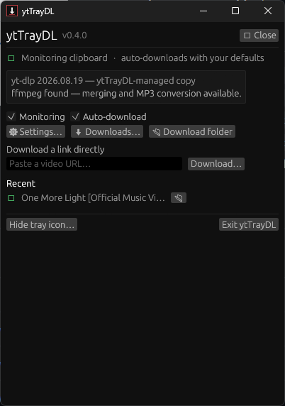
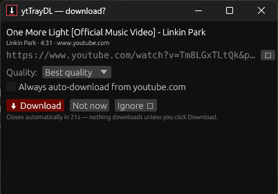
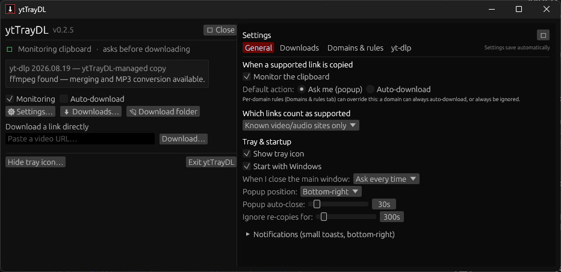
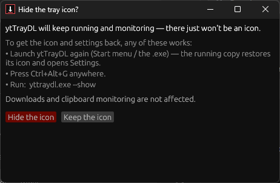

# ytTrayDL

**Copy a video link. It downloads.** ytTrayDL is a small Windows system-tray
companion for [yt-dlp](https://github.com/yt-dlp/yt-dlp). It watches your
clipboard, and when you copy a link from a site yt-dlp supports, it either
pops up a small window with download options — or, if you've told it to,
downloads quietly in the background with your defaults while you keep working.


## TL;DR

ytTrayDL watches your clipboard for video links and downloads them
with yt-dlp: it asks first (a popup with a quality choice) or
downloads silently with your defaults — your rules per site, no
duplicates, nothing leaves your PC. It's for anyone who downloads
videos regularly and wants it to feel built into Windows rather
than like a chore in a terminal. Free and open source (MIT),
for Windows 10/11, in 64-bit and 32-bit builds, as an installer
or a portable zip.

## How it works

1. Run `yttraydl.exe`. The control panel opens; close it and the
   app keeps running in the system tray (notification area). Only
   Start-with-Windows launches skip the panel and go straight to
   the tray.
2. Copy a link — from a browser, a chat app, anywhere.
3a. **Ask mode (default):** a small popup appears near the corner of your
    screen with the video's title, a quality selector, and Download /
    Not now / Ignore options.
3b. **Auto-download mode:** no popup at all. The download starts immediately
    with your default quality and folder; a small toast confirms it finished
    (and failures are always reported, never silent).

Right-click the tray icon to pause monitoring, switch modes, open Settings,
open the download folder, and more. Left-click toggles the control panel —
click once to show it, click again to hide it.

## Highlights

- **Real clipboard events, not polling** — ytTrayDL registers as a Windows
  clipboard format listener (`AddClipboardFormatListener` /
  `WM_CLIPBOARDUPDATE`), so it reacts instantly and idles at zero cost.
- **Per-domain rules** — ignore a domain forever, auto-download from the
  ones you trust, allow extra domains beyond the built-in list.
- **Sensible scope** — by default only known video/audio sites trigger it;
  ordinary web links don't. Switch to "any link" if you use yt-dlp's
  long-tail sites.
- **No duplicates** — re-copying the same link doesn't re-trigger, and a
  yt-dlp download archive means previously downloaded videos are skipped
  (the popup offers "Download anyway" when yt-dlp detects one).
- **Progress you can see** — live percent, speed and ETA in the panel and
  Downloads window, parsed from yt-dlp's own output.
- **Full queue control** — in the Downloads window: reorder what's next,
  pause and resume (a resume continues the partial file, it doesn't
  restart it), retry failures with their original quality, and pause
  or cancel everything at once — Pause all is in the tray menu too.
- **Quality by domain** — pin a quality per site ("this domain always
  ≤720p, that one always MP3"): the popup starts there and
  auto-downloads use it too.
- **Playlists, your call each time** — a playlist link asks in the popup:
  just this video, or the whole playlist.
- **Cleaner downloads** — optional SponsorBlock segment removal,
  a Windows taskbar progress bar while downloads run, an optional
  finish sound, and drag-and-drop: drop a text file of links onto
  the panel and they're processed like copied links.
- **Hide the tray icon if you want** — with three ways back: relaunch
  ytTrayDL, press **Ctrl+Alt+G**, or run `yttraydl.exe --show`. The
  confirmation dialog explains this before hiding, so you can't lock
  yourself out.
- **First-run friendly** — if yt-dlp isn't installed, one click downloads
  the official standalone `yt-dlp.exe` from GitHub into ytTrayDL's own
  folder. Same for ffmpeg: if it's missing, one click downloads the GyanD
  essentials build (the Windows build ffmpeg.org links to) and unpacks
  it next to yt-dlp. Best-quality merging and MP3 conversion need ffmpeg.
- **Closing the window is your choice** — the X button asks: Exit,
  minimize to tray, minimize to taskbar, or hide entirely (keeps
  running in the background; **Ctrl+Alt+G**, relaunching, or `--show`
  brings it back). Tick "Remember my choice" to stop being asked, and
  change it any time in Settings → General.
- **Private by design** — no accounts, no telemetry, nothing leaves your
  PC except the requests yt-dlp itself makes. Settings live in
  `%APPDATA%\ytTrayDL`.

## Screenshots

The control panel — status, manual link downloads, recent activity:



Copy a link and the popup asks first — title, quality, one click
to download:



Settings slide out from the side of the main window:



Hiding the tray icon is always explained first — and always
recoverable:



## Quick start

Two ways to get it from the
[Releases page](https://github.com/SeanShaffer88/ytTrayDL/releases)
— every download comes in 64-bit (`-x64`) and 32-bit (`-x86`)
builds; the 32-bit build also runs on 64-bit Windows:

- **Installer** — `ytTrayDL-Setup-vX.Y.Z-windows-x64.exe` (or
  `-windows-x86.exe`): per-user install (no admin) to
  `%LOCALAPPDATA%\Programs\ytTrayDL`, with a Start-menu entry,
  optional desktop shortcut and start-with-Windows, and a
  standard uninstaller. Your settings/history in
  `%APPDATA%\ytTrayDL` are kept on uninstall.
- **Portable zip** — `ytTrayDL-vX.Y.Z-windows-x64.zip` (or
  `-windows-x86.zip`): unzip anywhere and run `yttraydl.exe`.
  Nothing is installed.

Then:

1. Run it. If yt-dlp is missing, the panel opens with an **Install yt-dlp**
   button.
2. Copy any supported link and try it.

Optional: enable **Start with Windows** in Settings (per-user, no admin
needed). If ffmpeg is missing, use the panel's **Install ffmpeg** button
(or drop `ffmpeg.exe` next to `yttraydl.exe` / on PATH yourself).

## Configuration tour

**Settings → General** — monitoring on/off, default action (Ask /
Auto-download), detection scope, popup position and auto-close timer,
dedupe window, which notifications you want, tray icon visibility,
start-with-Windows.

**Settings → Downloads** — download folder, file-name template, default
quality preset (Best, up to 2160p/1440p/1080p/720p/480p/360p, audio MP3,
audio original, or a custom yt-dlp format string), container (MP4/MKV/
original), embed thumbnail/metadata/subtitles, playlist behaviour,
SponsorBlock segment removal, simultaneous download count, a speed
limit, auto-retry for failed downloads, extra yt-dlp arguments, and
browser cookies from a dropdown (Chrome, Edge, Firefox, Brave, Opera,
Vivaldi, Chromium — for signed-in content; yt-dlp reads them, ytTrayDL
never sees them).

**Settings → Domains & rules** — the ignored / auto-download / allowed
domain lists, per-domain quality pins, and ignored specific links,
with the rule order explained.

**Settings → yt-dlp** — the yt-dlp/ffmpeg copies in use, one-click
install/update, a "Check for yt-dlp updates" button that compares
your copy against the latest GitHub release, and export/import of
all settings (rules included) as a JSON file.

**Tray menu** — pause/resume monitoring, auto-download toggle, "Download
from clipboard" (acts on what's copied *now*), Downloads, download
folder, pause/resume all downloads, Settings, start-with-Windows,
hide icon, About, Exit.

**Command line**

| Argument | Effect |
| --- | --- |
| `yttraydl.exe --show` (or `--settings`) | If already running: restore the tray icon and open Settings. If not running: start with the panel open. |
| `yttraydl.exe --background` | Start in the tray without opening the panel (used by Start-with-Windows). |
| `yttraydl.exe https://…` | Treat the URL like a copied link (opens the download popup). |

## Building

Rust 1.80+ (stable). The library (settings, URL detection, rules,
yt-dlp command building, download manager) is platform-independent and
fully unit-tested; the tray/Win32 parts compile for Windows.

```powershell
cargo build --release          # produces target\release\yttraydl.exe
cargo test                     # full test suite (unit + end-to-end)
cargo clippy --all-targets     # lint gate (CI also lints/checks both Windows targets, x86_64 and i686)
```

Windows 10 and 11 are the target platforms. A release is a single
self-contained `.exe` — put `yt-dlp.exe` beside it, install it from the
app, or have it on PATH.

## Status & verification

v0.3.0. The core library is covered by unit tests and the whole crate
(including the Win32 clipboard listener and tray code) is compile-checked
and linted for both `x86_64-pc-windows-msvc` and `i686-pc-windows-msvc`
in CI. Runtime behaviour on a real Windows machine is tracked in
[docs/DESIGN.md](docs/DESIGN.md#verification-matrix) with Verified /
Partially verified / Unverified labels — nothing is claimed as
runtime-verified until it has run on a real PC. Current state: the
tray menu and its actions are verified on a real PC (v0.2.7 field
test, October 2026), and the v0.2.8 left-click toggle builds on the
same verified mechanism; the v0.2.9 queue controls and popup
positions and the v0.3.0 additions (quality pins, popup playlist
choice, taskbar progress, drag-and-drop, import/export, update
check) are logic-tested but not yet field-verified, and the
installer, the in-app ffmpeg install, the close-choice dialog, and
an end-to-end download still await a full on-machine pass.

## Contributing

Issues and pull requests are welcome. If you're changing code,
please run the project gate first (see [AGENTS.md](AGENTS.md)):
`cargo fmt`, clippy on the host and both Windows targets
(x86_64 and i686), and the full test suite — CI runs the same
checks. Screenshots in this README are real captures from a
Windows machine; please don't add placeholder images.

## License

MIT — see [LICENSE](LICENSE). ytTrayDL drives yt-dlp as a separate
program; yt-dlp is published by its authors under the Unlicense.
